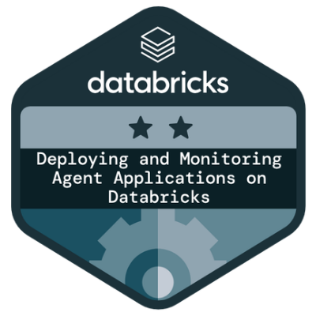

## Data portfolio
- **RAG pipeline demo** [(view project)](rag): a Streamlit RAG application for querying a section of the FCA Handbook, using LangChain, Hugging Face's all-MiniLM-L6-v2 embeddings, a FAISS vector store and OpenAI's gpt-oss-20b via Groq, DeepEval evaluation, MLflow model logging. [View and try chatbot app](https://fca-compliance-assistant.streamlit.app/)
- **Marketing project** [(view project)](marketing): data cleaning and EDA, XGBoost profit maximisation model and SHAP analysis, RFM segmentation. [View Tableau interactive RFM dashboard](https://public.tableau.com/app/profile/data.granate/viz/MarketingRFMdashboard/Dashboard12)

I am a data professional with over 10 years of experience, available immediately for remote, remote-first or hybrid roles. I specialise in turning complex data into measurable business outcomes, from insight-driven analysis and ETL pipelines to advanced predictive modelling and generative AI solutions.

My approach balances rigorous statistical analysis with practical business application, delivering solutions that stakeholders can act on immediately.

## Core capabilities

- **Insight-driven analysis:** Translating ambiguous briefs into clear, actionable strategies
- **Predictive modelling:** Applying machine learning to solve business problems like churn reduction and revenue optimisation
- **Generative AI and agentic systems:** Building RAG pipelines, agentic applications, and LLM evaluation frameworks
- **Data engineering and pipelines:** Building robust ETL/ELT processes and automated reporting
- **Advanced visualisation:** Designing clear, stakeholder-ready dashboards and visualisations. Data storytelling

## Technical toolkit
- **Core languages:** Python (NumPy, Pandas, Scikit-learn, PySpark, PyTorch), R (tidyverse), SQL (complex queries, UDFs, optimisation)
- **Data platforms:** Azure Databricks, Google Cloud Platform (BigQuery, GCS), MS SQL Server
- **Machine learning:** Feature engineering, A/B testing, hypothesis testing, statistical modelling,  NLP, SHAP
- **GenAI and LLMs:** RAG architectures, LLM orchestration (LangChain, Groq, Hugging Face), prompt/context engineering, vector search (FAISS/Chroma), evaluation (DeepEval)
- **MLOps and DevOps:** Git, dbt, Docker, Kubernetes, MLflow (tracing, experiment tracking), GitHub Actions, Grafana
- **Data visualisation:** Power BI (DAX, PowerQuery), Tableau, R Shiny, Matplotlib, Seaborn, ggplot2
- **Other:** Advanced Excel (DAX, Power Query, VBA)

| | |
|---|---|
|  |  |
