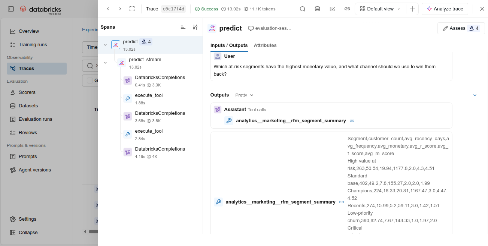
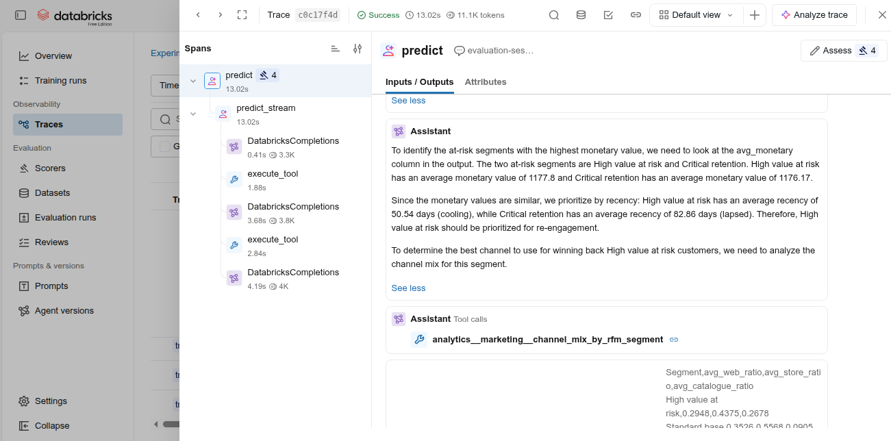
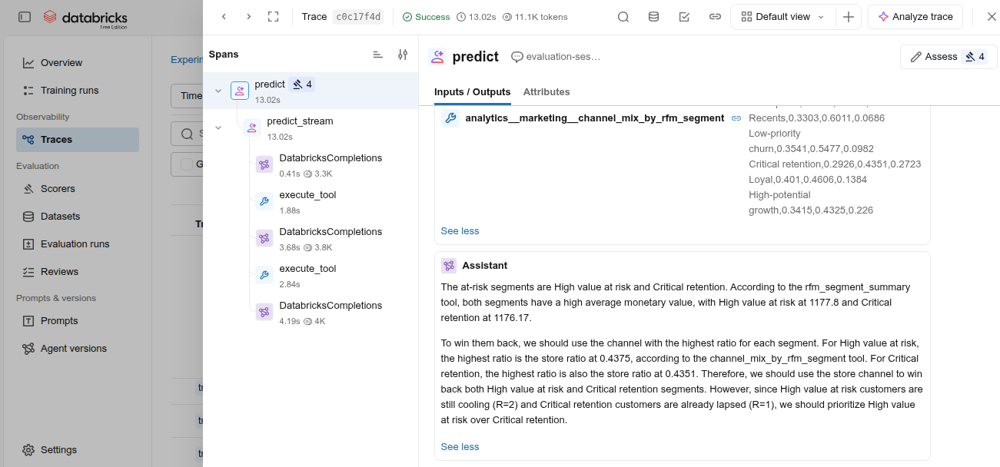
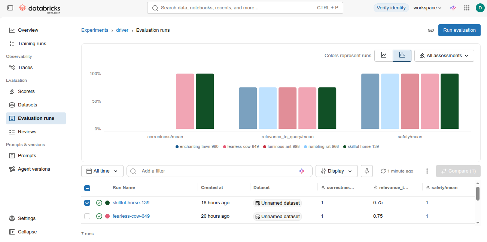
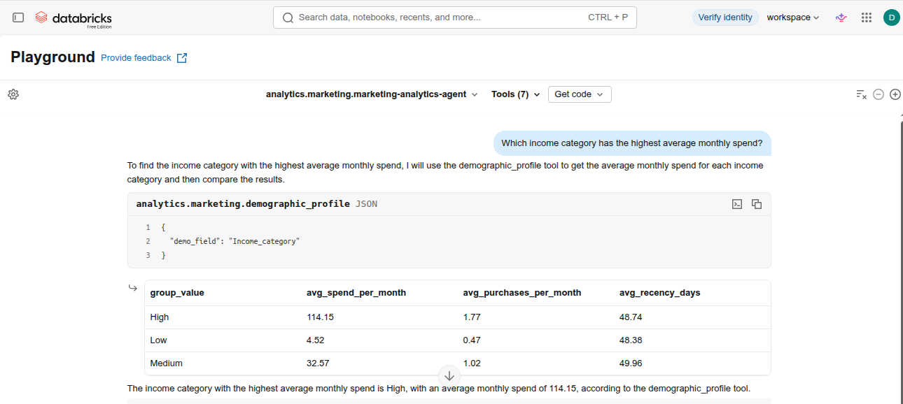

## Agentic marketing analytics demo on Databricks

A proof-of-concept **agentic application on Databricks** that demonstrates reliable tool use and domain-specific reasoning. The agent uses parameterised SQL functions to query customer data, with safeguards against injection and hallucination. It was evaluated using MLflow to verify correctness and safety, showing strong performance on multi-hop queries and refusal cases.

This project is a **Databricks-native application** and requires a Databricks workspace to run. The code will not execute outside of a Databricks environment without significant refactoring of these integrations. To view the logic, read the `.py`/`.ipynb` files directly.

#### Approach
- **Data:** Aggregated customer dataset with RFM segmentation (see my [Marketing project](../marketing), especially [marketing_rfm.ipynb](../marketing/notebooks/marketing_rfm.ipynb) and [marketing_rfm.csv](../marketing/data/processed/marketing_rfm.csv))
- **Tools:** Seven parameterised SQL UDFs (demographics, channel mix, deal affinity, RFM segments)
- **Agent:** LLM with tool-calling capability, system prompt encoding domain knowledge
- **Evaluation:** MLflow scorers `Correctness`: 1.0, `Safety` 1.0, `RelevanceToQuery`: 0.75 (fails on refusal cases, expected))
- **Injection guards:** whitelist-based parameter validation in all SQL UDFs; no f-string interpolation of user input
- **Domain logic:** system prompt incorporates RFM segment information and priorities
- **Guardrails:** agent refuses out-of-scope queries (eg "Platinum segment") rather than hallucinating

#### Screenshots
*MLflow Tracing output showing the agent's tool calls and intermediate reasoning steps*

*MLFlow evaluation runs (note `Correctness` was added for the last two runs)*

*Example questions, the first answered and the second correctly refused answered by the agent*

#### Directory structure
- `notebooks/`  Iterative development: data setup, tool creation, agent config and evaluation
- `src/` — Inference code generated from agent definition
- `data/`  CSV of customerbehaviour data from Marketing project
- `assets/`  Screenshots of selected traces, eval and chat from Databricks UI

#### Deployment note

Built using the deployment pattern of model registration ->  Model Serving endpoint. A future refactor will port this to **Databricks Apps** and additional agent(s).